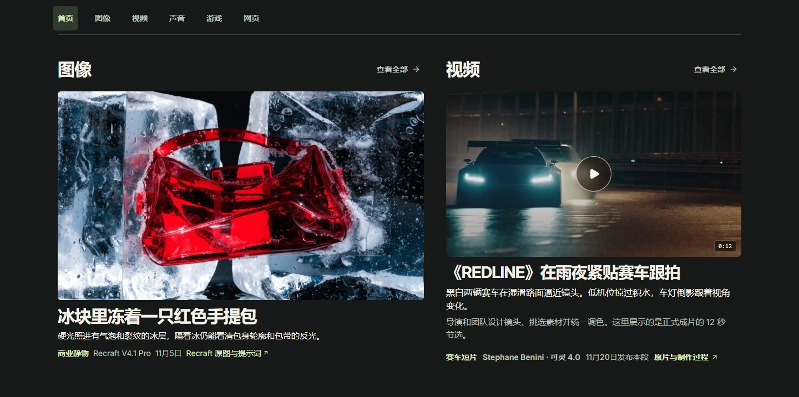

# AI Now

通过真实作品了解 AI 做到了哪一步。看一张原图、拖动一次前后对照，或用十几秒看完一段原片。

**[打开 AI Now](https://ai-now-cn-261113.wp9617.chatgpt.site/)** · 中文 · 无需登录

[](https://ai-now-cn-261113.wp9617.chatgpt.site/)

每件作品都附原作者出处。用到参考素材、人工剪辑或其他制作协作时，页面会写清这些条件。

- **图像** · 玻璃壶被移到柠檬篮后，遮挡和倒影一起变化。[拖动对照](https://ai-now-cn-261113.wp9617.chatgpt.site/topics/images#glass-pitcher-edit)
- **视频** · 两辆车在湿滑赛道贴近镜头，车灯沿积水掠过。[看《REDLINE》](https://ai-now-cn-261113.wp9617.chatgpt.site/topics/video#redline)
- **声音、游戏与网页** · 听电子舞曲副歌，试玩教堂首领战，体验网页打字机。[声音](https://ai-now-cn-261113.wp9617.chatgpt.site/topics/audio) · [游戏](https://ai-now-cn-261113.wp9617.chatgpt.site/topics/software) · [网页](https://ai-now-cn-261113.wp9617.chatgpt.site/topics/creative)

## 本地运行

需要 Node.js 22.13 或以上。启动开发预览后，打开终端显示的地址。

```sh
npm ci
npm run dev
```

[项目结构与发布](docs/development.md) · [选材与验收](docs/editorial.md) · [版本记录](docs/releases.md)

展示素材的使用条件以原作者或发布平台的说明为准。首页预览中的图像来自 [Recraft](https://www.recraft.ai/blog/gpt-image-2-6)，视频来自 [Stephane Benini 的《REDLINE》](https://kling.ai/blog/hitting-redline-make-cinematic-racing-kling4)。
